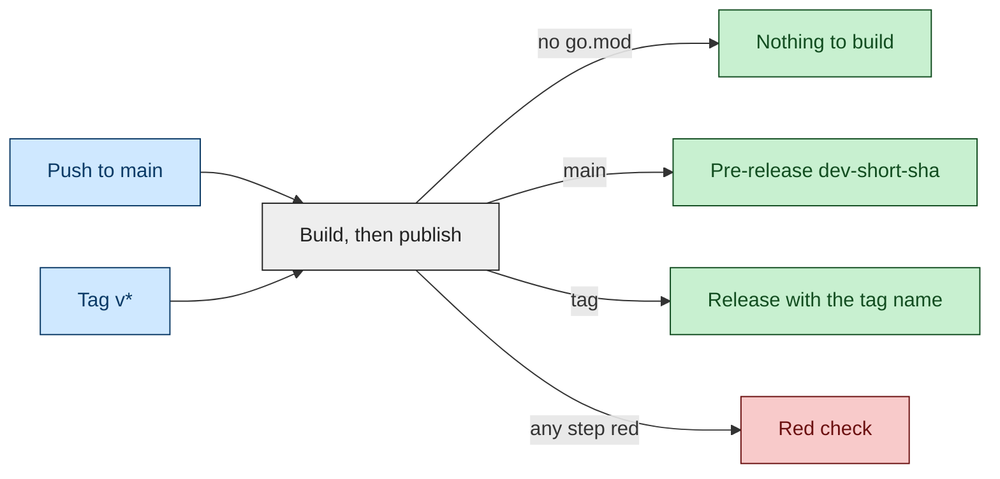
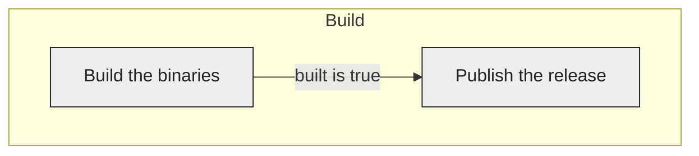

# Pipeline docs: Vcs build

This page draws the build pipeline of vcs and explains it. It follows the
[CI pipeline style guide](../../.claude/agent-standards/docs/Topics/CI-Pipelines.md).

| Workflow | File | Starts on |
|---|---|---|
| Build | `.forgejo/workflows/build.yml` | A push to `main`, and a tag `v*` |

## Build

### Purpose

The pipeline builds the `vcs` binary for six targets. A push to `main` makes a dev build. A
tag `v*` makes a release. This way, anyone can download a binary.

### Triggers

| Event | Filter | Who or what starts it |
|---|---|---|
| `push` | Branch `main` | A merged pull request |
| `push` | Tag `v*` | The owner, who pushes a release tag |

### Flow diagram



### Job graph



### Jobs

| Job id | Name | Runner | What it does | Needs |
|---|---|---|---|---|
| `build` | Build the binaries | `ubuntu-latest` | Names the version, builds six binaries and a checksums file, uploads them as artifacts | None |
| `publish` | Publish the release | `ubuntu-latest` | Creates the Forgejo release and attaches each file | `build` |

### Steps

`build`:

1. Check out the repo with full history.
2. Name the version. A tag gives the tag name. A push to `main` gives `dev-` and the
   8-character short sha.
3. Build. `go.mod` is missing today, so the step prints a note, sets `built=false`, and
   stops. This keeps the pipeline green until the Go code lands.
4. Build runs `go build` for each of `linux`, `darwin`, and `windows`, on `amd64` and `arm64`.
   `CGO_ENABLED=0` lets one runner cross-build all six.
5. Write `vcs_<version>_checksums.txt` with `sha256sum`.
6. Upload `dist/*` as one workflow artifact. The artifact action is `v3`, because Forgejo does
   not support `v4`.

`publish` (runs only when `built` is true):

1. Download the artifact.
2. Create the release through the Forgejo API. A dev build is a pre-release on a new tag
   `dev-<short sha>`. A `v*` tag is a full release on the tag that exists.
3. Attach each file to the release.

File names are `vcs_<version>_<os>_<arch>`, with `.exe` on windows.

### Inputs

| Input | Type | Default | Meaning |
|---|---|---|---|
| `CGO_ENABLED` | env | `0` | Builds with no C bindings, so cross-builds work |

### Secrets

| Secret | Used by | What it lets the job do |
|---|---|---|
| `RELEASE_TOKEN` | `publish` | Optional. Overrides the job token when the job token can't write releases |
| `github.token` | `publish` | The job token. The default for the release calls |

### Outputs

| Output | Made by | Where it goes |
|---|---|---|
| Workflow artifact `vcs-<version>` | `build` | The run page |
| Release and six binaries and a checksums file | `publish` | Releases of `packages/vcs` |
| Job outputs `version` and `built` | `build` | The `publish` job |

### Runners

| Label | Image | Pin |
|---|---|---|
| `ubuntu-latest` | `ghcr.io/matthewbaggett/act-runner:php8.5-tools` | The tag in `container:` of each job. The image has Go |

### Failure modes

| Symptom | Cause | Fix |
|---|---|---|
| `publish` gets HTTP 401 or 403 | The job token can't write releases | Add the secret `RELEASE_TOKEN`, a token with release write access |
| `publish` gets HTTP 409 or 422 | The tag or release exists already, for example after a re-run | Delete the release and its tag, then re-run |
| `build` fails on `go build` | A compile error, or no `./cmd/vcs` | Fix the code. Run the build locally |
| Upload step fails | The artifact action is too new for Forgejo | Keep `upload-artifact` and `download-artifact` on `v3` |
| actionlint warns the `v3` actions are too old | actionlint targets GitHub, not Forgejo | Ignore it, or run `actionlint -ignore 'too old to run'` |

Dev builds pile up. Each push to `main` adds a pre-release and a tag. No step prunes them yet.

### Local run

```bash
act push -W .forgejo/workflows/build.yml --job build
```

The `publish` job needs a Forgejo server. Don't run it on your machine.
